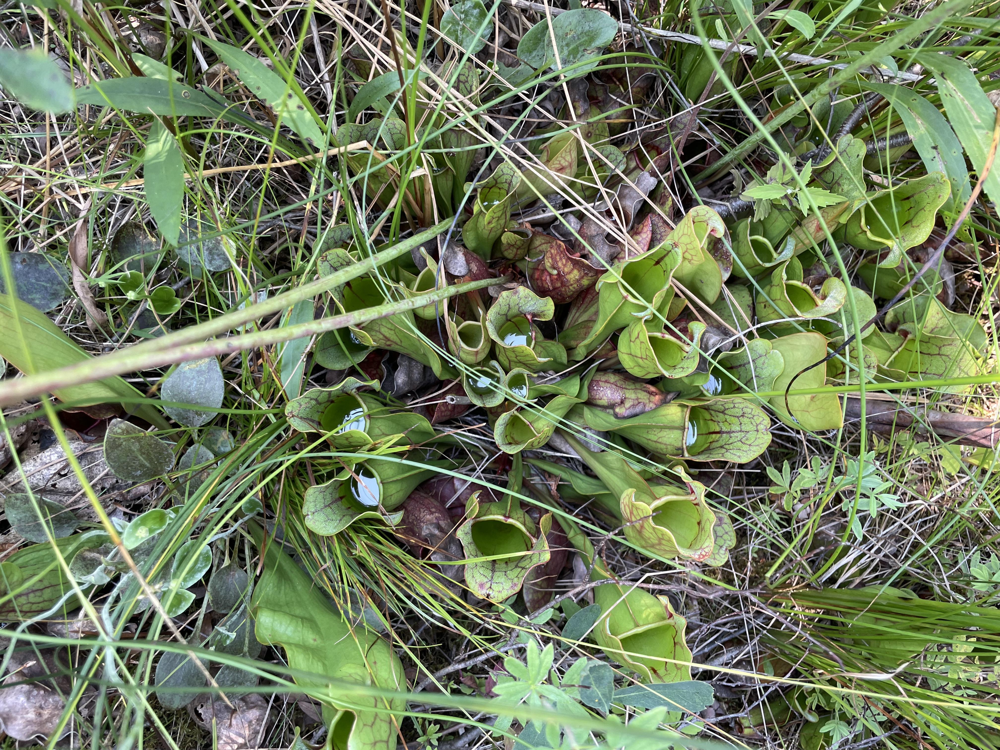

::::: {.column-screen .color-band}
:::: column-body
::: {style="font-size: 2em;"}
How do species coexist?
:::
::::
:::::

::: {style="text-align: center;"}
Across Earth's ecosystems, we find an extraordinary diversity of life.
Some species sharing a habitat are strikingly different from one
another, like a deer and an oak tree. Others are remarkably similar,
like Monarch and Viceroy butterflies. Yet whether they are very
different or nearly indistinguishable, neighboring species must find
ways to coexist in environments where space, food, and other resources
are limited.

So why do some species persist alongside one another, while others are
outcompeted and disappear?

My research explores these questions using the tiny aquatic ecosystems
that form inside the leaves of purple pitcher plants. These carnivorous
plants collect rainwater in their cup-shaped leaves, creating miniature
habitats inhabited by a diverse community of microorganisms. Among these
are approximately 45 species of protists (single-celled organisms with
complex cell structures) that interact, compete, and coexist within the
pitcher plant food web.

By studying this relatively simple community of closely interacting
species, I can experimentally test ecological theories about
competition, coexistence, and community assembly. We've got about a
century of theoretical development research from which to draw
mathematical tools for predicting how species interact and whether they
can persist together. My goal is to understand how well these
predictions hold up against the complexity of real biological
communities, and ultimately what these small microbial ecosystems can
teach us about the processes that maintain biodiversity in nature.
:::

::::: {.column-screen .color-band-small}
:::: column-body
::: {style="font-size: 1.25em;"}
How well can we predict species interaction outcomes?
:::
::::
:::::

{fig-align="center" width="258"}

When two species rely on similar resources and compete for space, food,
or other necessities, sometimes they find a way to persist alongside one
another. Other times, one species eventually out-competes the other, and
in still others, it depends on the inital conditions in which species
are introduced to one another (priority effects).

My research explores this question using five protist species that
naturally inhabit pitcher plant leaves. In a laboratory setting, I
measured how each species grows on its own and how its growth changed
when competing with another species. I used these measurements to build
mathematical models that predict what will happen when different pairs
of species compete.

Importantly, I did't stop at making predictions. I conducted separate
experiments to see whether the outcomes predicted by my models actually
matched what happened when these organisms compete. Our results suggest
that ecological theory can often predict *whether* competing species
will coexist, but predicting *how much* of each species will remain is
considerably more challenging.

::::: {.column-screen .color-band-small}
:::: column-body
::: {style="font-size: 1.25em;"}
How do changing temperatures alter coexistence potential and our ability
to predict it?
:::
::::
:::::

{fig-align="center" width="290"}

Species interactions don't happen in isolation from the environment.
Temperature, for example, influences how quickly organisms grow, how
efficiently they use resources, and how well they tolerate competition.
As the world warms and environmental conditions change, the balance of
competition between species can shift, potentially changing which
species are able to coexist.

Building on my work predicting the outcomes of pairwise competition, I
am investigating how temperature influences both species interactions
and our ability to predict them. Using the same five species of pitcher
plant protists, I plan to repeat my pairwise competition experiments
across a range of temperatures, from the lower to upper limits of
temperatures the protists experience in their native habitat. I will use
these experiments to measure how competition changes across temperatures
and evaluate whether mathematical models parameterized under different
environmental conditions can accurately predict the resulting community
dynamics.

Ultimately, this research asks whether the rules governing species
coexistence remain consistent as environmental conditions change, or
whether shifts in temperature fundamentally alter the outcome of
competition.

::::: {.column-screen .color-band-small}
:::: column-body
::: {style="font-size: 1.25em;"}
How predictable is community assembly?
:::
::::
:::::

{fig-align="center" width="295"}

Biodiversity isn't distributed evenly across a landscape. Even when
neighboring habitats are physically similar, they can develop
surprisingly different communities of organisms. Predicting community
assembly requires understanding how dispersal, spatial structure, and
historical contingency interact in natural systems.

Because individual pitcher leaves offer relatively similar environments
but can develop different microbial communities, they provide a natural
system for investigating community assembly. To understand how these
differences arise, I pair sterilized "recipient" pitchers with
neighboring, undisturbed "donor" pitchers in a native bog and track
community development over time. By characterizing variation in
established donor communities and comparing it with the communities that
develop in recipient pitchers, I can investigate how the diversity of
existing communities influences the range of assembly outcomes in newly
available habitats.

Ultimately, this research asks whether ecological communities assemble
according to predictable rules or whether their trajectories are
fundamentally contingent on the circumstances of their formation.
Understanding the balance between these processes is essential for
predicting how biodiversity is distributed across landscapes and how
ecological communities might respond to environmental change.
