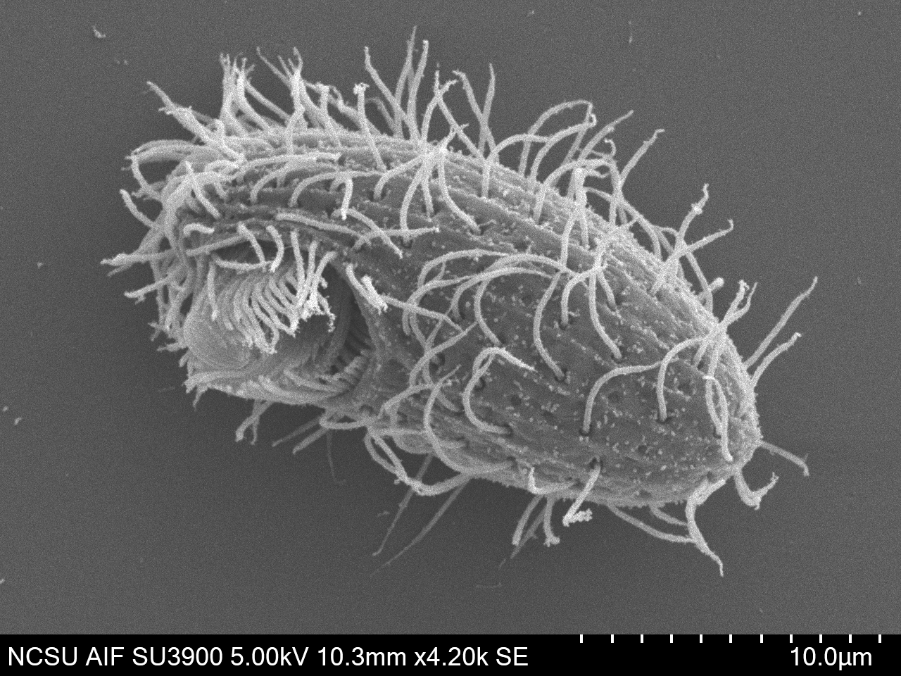
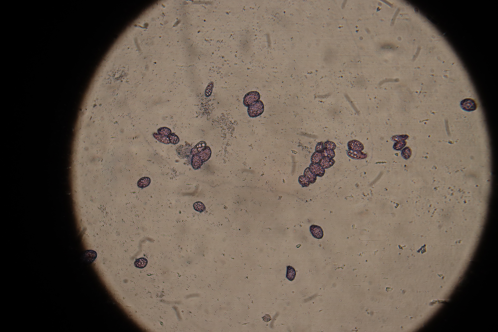

::::: {.column-screen .color-band}
:::: column-body
::: {style="font-size: 2em;"}
How do species coexist?
:::
::::
:::::

::: {style="text-align: center;"}
Across Earth's ecosystems, we find an extraordinary diversity of life.
Some species sharing a habitat are strikingly different from one
another, like a deer and an oak tree. Others are remarkably similar,
like Monarch and Viceroy butterflies. Yet whether they are very
different or nearly indistinguishable, neighboring species must find
ways to coexist in environments where space, food, and other resources
are limited.

So why do some species persist alongside one another, while others are
outcompeted and disappear?

My research explores these questions using the tiny aquatic ecosystems
that form inside the leaves of purple pitcher plants. These carnivorous
plants collect rainwater in their cup-shaped leaves, creating miniature
habitats inhabited by a diverse community of microorganisms. Among these
are approximately 45 species of protists (single-celled organisms with
complex cell structures) that interact, compete, and coexist within the
pitcher plant food web.

By studying this relatively simple community of closely interacting
species, I can experimentally test ecological theories about
competition, coexistence, and community assembly. We've got about a
century of theoretical development research from which to draw
mathematical tools for predicting how species interact and whether they
can persist together. My goal is to understand how well these
predictions hold up against the complexity of real biological
communities, and ultimately what these small microbial ecosystems can
teach us about the processes that maintain biodiversity in nature.
:::

{fig-align="center" width="263"}

::::: {.column-screen .color-band}
:::: column-body
::: {style="font-size: 1.25em;"}
How well can we predict species interaction outcomes?
:::
::::
:::::

#Main txt

{fig-align="center" width="245"}

::::: {.column-screen .color-band}
:::: column-body
::: {style="font-size: 1.25em;"}
How do changing temperatures alter coexistence potential and our ability
to predict it?
:::
::::
:::::

#Main txt

{fig-align="center" width="238"}

::::: {.column-screen .color-band}
:::: column-body
::: {style="font-size: 1.25em;"}
How does diversity propagate into newly available habitat patches?
:::
::::
:::::

#Main txt